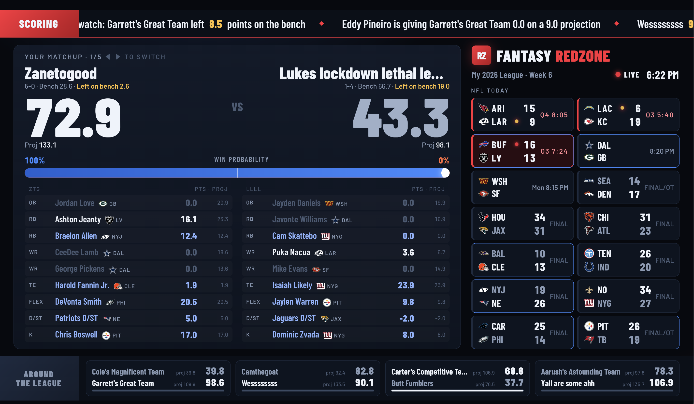

# Fantasy RedZone

A live ESPN fantasy football board for the TV. It shows your matchup with
big scores and a win-probability tug-of-war, the rest of the league on the
side, and a scoring crawl along the bottom. When one of your players scores,
the screen flashes, an air horn plays, and the play is announced.

Plain Python 3, nothing to install.

## 1. Try it (no ESPN needed)

    python3 server.py --demo

Open http://localhost:8787. The demo fakes a league and scores roughly every few seconds.

## 2. Hook up your league

    cp config.example.json config.json

Set `league_id` to the number after `leagueId=` in your league's URL, and `season` to the
current year. Then fill in `espn_s2` and `swid`. While logged in at fantasy.espn.com in Chrome:
DevTools → Application → Cookies → https://fantasy.espn.com. Then:

    python3 server.py --teams     # lists team ids; put yours in "my_team_id"
    python3 server.py

`config.json` holds your ESPN login, so keep it on this machine.

## 3. Get it on the TV

The server runs on a laptop, a Pi, or any always-on machine. The TV only displays the page,
at `http://<that-machine's-IP>:8787`.

- **Google TV / Android TV**: cast a Chrome tab to the TV, or install a TV browser app (such as TV Bro) and open the URL.
- **Roku TV** (no real browser): AirPlay your screen from a Mac, or use a Raspberry Pi on HDMI in kiosk mode (works on any TV):

      chromium-browser --kiosk --autoplay-policy=no-user-gesture-required http://<server-ip>:8787

  The autoplay flag lets the air horn work without a click.

On a TV browser without that flag, press OK or click once to turn on sound.

## Optional: a real voice for the calls

Without this, the browser's built-in voice reads the scoring calls. Set `kira_voice_url` to a
text-to-speech endpoint that takes `POST {"text": "..."}` and returns a wav. The server forwards each
line there, and if the endpoint fails, the browser voice reads the line instead. For example, point it at a
[Kokoro](https://github.com/thewh1teagle/kokoro-onnx) server on another machine.

To run the board on a Raspberry Pi as a service, see `deploy/PI.md`.

## Optional: Home Assistant lights

Set `home_assistant_webhook` to a webhook URL, such as
`http://homeassistant.local:8123/api/webhook/fantasy_td`. The server POSTs JSON
for every big play in your matchup. The payload includes `for_me` (true = your
player, false = your opponent's), `kind` (`td` or `big`), `player`, and `gain`.
Trigger an automation on it, for example flashing the lights blue for you and red for them.

## Notes

- ESPN's fantasy API is unofficial and can change without notice. If the board breaks,
  `fetch_live()` in `server.py` is the only place that talks to ESPN.
- Touchdowns are inferred: a starter jumping 5.5 or more points between polls counts as a TD,
  and 3.5 or more counts as a big play. The default `poll_seconds` is 30.
- `python3 server.py --dump dumps` does one poll, saves ESPN's raw responses plus the parsed
  board to `dumps/`, and exits. Start there if the board shows wrong numbers.
- Win probability is a rough estimate based on projections and how many points are left to play.

## License

MIT. Not affiliated with ESPN.
